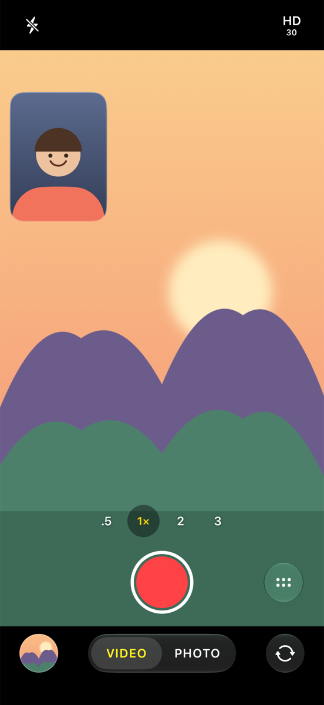
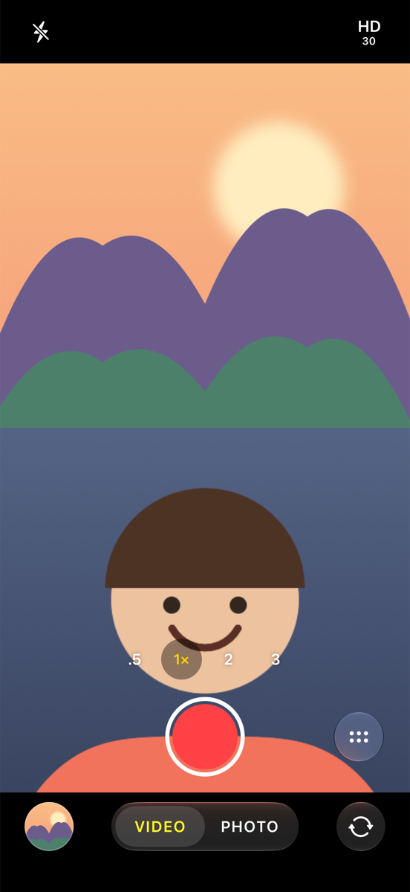
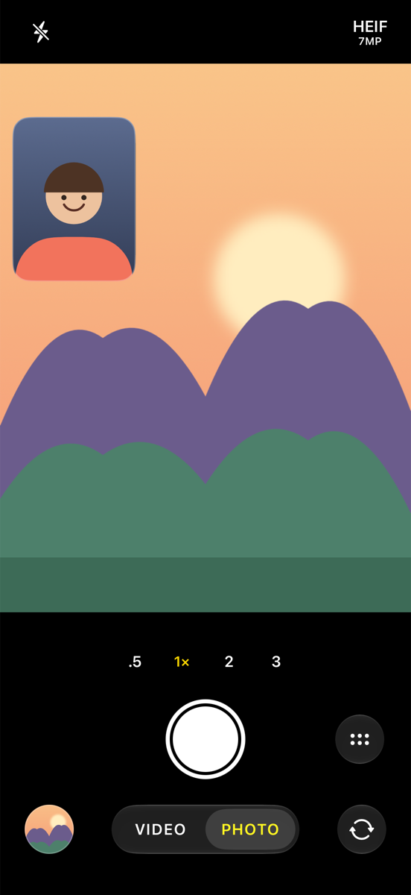
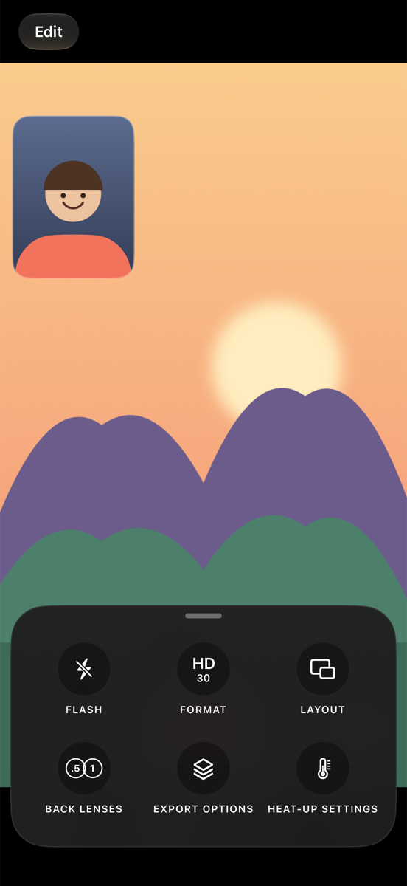

<p align="center"></p>

<h1 align="center">DualShot</h1>
<p align="center"><b>Front and back camera at the same time, on the iPhone you already have.</b></p>
<p align="center"><a href="https://harkhowalia-1.github.io/DualShot/">Website</a> · App Store release coming soon</p>

---

Apple's **Dual Capture**, which records the front and back cameras at once, only exists on the iPhone 17 lineup (iPhone 17, iPhone Air, iPhone 17 Pro and Pro Max). But every iPhone with an A12 chip or newer, from **iPhone XS and XR** on, has been able to run two cameras at once since iOS 13.

DualShot uses that ability, so you get dual-camera video and photos on the iPhone you already own.

<p align="center">
  
  
  
  
</p>

## Features

- **Two cameras, two files.** The back and front cameras are saved as separate videos, ready to edit, plus a combined video in your layout.
- **Picture in picture or split.** Drag the front window to any corner, or split the screen.
- **Photo mode.** Take a photo with both cameras at once, in HEIF or JPEG, with flash and a self-timer.
- **Zoom while recording.** Switch between .5×, 1×, 2× and 3× mid-take; DualShot handles the lens pairs your iPhone can run next to the front camera.
- **Heat-Up Settings.** Lowers the frame rate as the iPhone warms up, so long takes keep going.
- **Matched to your iPhone.** On first launch it measures what your iPhone can do, and offers only the resolutions and frame rates that will work, up to 4K.
- **Feels like the Camera app.** Controls are laid out the way iOS 27's Camera arranges them, including a customisable top row.

## Requirements

- iPhone XS, XS Max, XR or newer (A12 chip or later), iOS 17 or later
- Tested on iPhone 14 Pro. Reports from other models are welcome in [Issues](https://github.com/harkhowalia-1/DualShot/issues).
- iPad support is planned.

## Build it yourself

1. Install [XcodeGen](https://github.com/yonaskolb/XcodeGen): `brew install xcodegen`
2. Create `Config/Local.xcconfig` with your Apple team ID:
   ```
   DEVELOPMENT_TEAM = YOURTEAMID
   ```
3. Generate the project and open it:
   ```
   xcodegen generate
   open DualShot.xcodeproj
   ```
4. Run it on an iPhone. The Simulator has no cameras, but you can preview the interface with the launch argument `-DualShotDemo pip`.

`BLUEPRINT.md` explains how the capture engine works.

---

iPhone and iPad are trademarks of Apple Inc. DualShot is not affiliated with or endorsed by Apple.
